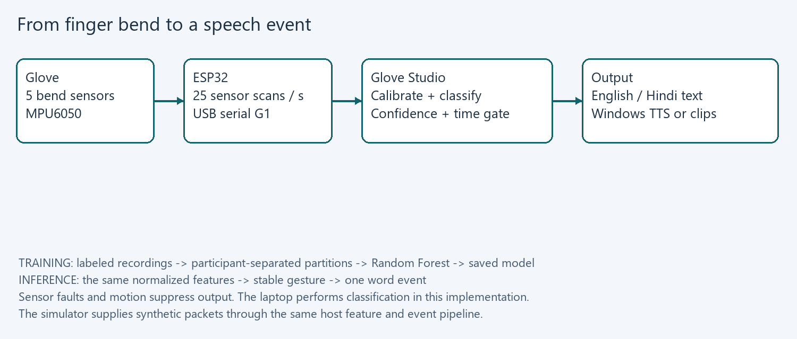
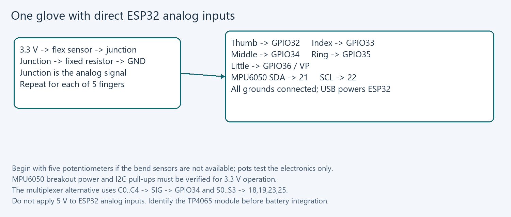
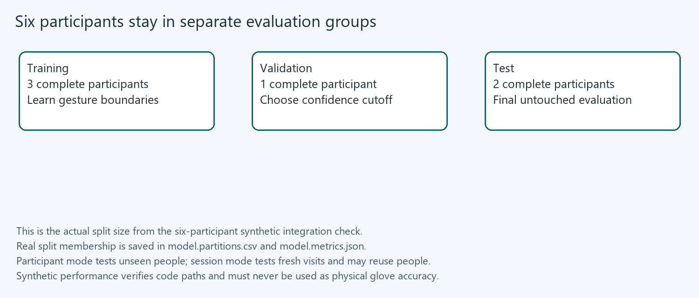

# Gesture to Speech Glove Build and Use Manual

Group 39 | ID1050A | IIT Palakkad | 3 October 2026

## 1 Your project and the starting point

This manual takes Group 39 from the supplied proposal to a working small-vocabulary gesture-to-speech prototype. The implemented system uses one ESP32 glove, five finger-bend inputs and an MPU6050, with recognition and speech on a Windows laptop. A second glove and wearable audio have optional firmware configurations.

Available hardware confirmed by Tarun: ESP32, MPU6050 and a module described as TP4065. Flex sensors, resistors, glove materials and interconnects still need to be assembled. Begin with USB power. The battery module needs its exact markings and circuit identified before wiring.

### What you can use immediately

1. Double-click Start-Glove-Demo.cmd in the project folder. It opens the packaged native application without installing Python.
2. Choose OPEN_PALM in Live recognition. Hold the simulated pose: its mapped phrase appears once. Choose REST, then OPEN_PALM again to test repeat control.
3. Select Check voices. Enable Auto speech only when you want audible output. English uses installed Windows voices; Hindi uses the included offline eSpeak NG voice.
4. Read the hardware chapter, gather five sensor channels and wire one glove. Use the calibration and recording tabs to build the real dataset.

### Evidence and completion boundary

Automated unit checks, serial loopback, native UI simulation, and synthetic collection/training/model reload are software verification. They do not establish physical recognition accuracy, fit, comfort, radio range or speech audibility. Record those measurements using the acceptance protocol in this manual. The supplied image alphabet model remains a separate CV experiment.

All eight word mappings are arbitrary team-defined demonstration gestures. They are not verified Indian Sign Language or American Sign Language signs. A small static recognizer does not capture language grammar, facial expression, two-hand relationships or continuous signing.

## 2 How the system works and why



A bend sensor changes electrical resistance when a finger bends. A resistor divider turns that change into a voltage. The ESP32 measures the five voltages and reads hand acceleration and rotation rate from the MPU6050. Firmware sends a complete packet about every 40 milliseconds; the host validates it before using it.

Calibration translates each finger reading into an approximate bend value from 0 to 1. The host also converts acceleration to a unit gravity direction and subtracts a stationary gyro bias. One glove therefore provides eleven features: five bends, three gravity-direction values and three normalized angular-rate values.

A Random Forest learns combinations of these numbers from labeled examples. Its highest class score is compared with a cutoff chosen using validation participants. A stable candidate must persist for 0.45 seconds before it generates a word event. REST must persist for 0.35 seconds to permit repeating the same word.

### Why the laptop is in the loop

The laptop provides a visible calibration tool, an editable dataset, repeatable training, metrics and installed speech engines. The ESP32 remains a sensor and optional audio endpoint. Embedded inference and an Android app are future ports; neither is represented as delivered here. This keeps the first demonstration measurable and makes failures easy to trace.

## 3 Prepare the hardware and your bench

| Item | Status and purpose |
| --- | --- |
| ESP32 and USB data cable | ESP32 confirmed. Verify the board is an original ESP32 DevKit/WROOM-compatible board; the build targets esp32dev. USB cable must carry data. |
| MPU6050 breakout | Confirmed. One IMU for the first glove; mount its axes consistently and inspect supply/pull-up wiring. |
| Five bend sensors | Needed for a physical glove. Commercial flex sensors or characterized DIY sensors; five potentiometers can first emulate them. |
| Five fixed resistors | Select near the measured straight sensor resistance; 10 kOhm is a bench starting point, not a guaranteed best value. |
| Glove and harness | Stretch glove, removable sensor sleeves, flexible wire, heat shrink and detachable connectors. |
| Meter and breadboard | Measure resistance, voltages, continuity and channel order before wearing the glove. |
| CD74HC4067 | Optional for one glove; useful for ten channels. Use HC at a verified 3.3 V supply in the ESP32 path. |
| TP4065 module | Exact identity unconfirmed. Keep disconnected during the first USB-powered build. |
| DFPlayer, speaker and SD card | Optional wearable recorded-word output; not needed for laptop speech. |

1. Record the exact board and module markings in the bench log. Photograph your own assembly for the final report.
2. With power removed, check the breadboard ground rail, resistor values and sensor continuity. Measure each sensor flat and comfortably bent; do not force the active region.
3. Start with one voltage divider and verify its output changes smoothly. Extend to five channels only after this works.
4. Use a data USB cable and close other serial monitors before connecting Glove Studio.

Why: faults are easier to locate in one channel than in a sewn, ten-sensor harness. Potentiometers can prove scanning, packets and calibration while the sensors are being sourced, but cannot prove wearable gesture performance. Obtain current quotes before purchasing; the old documents contain estimates rather than a verified current budget.

## 4 Wire the ESP32 and the sensors



1. Build each divider as 3.3 V -> sensor -> signal junction -> fixed resistor -> GND. Connect the five junctions to the pins in the diagram. This topology makes increasing sensor resistance lower the measured voltage.
2. Connect MPU6050 SDA to GPIO21, SCL to GPIO22 and GND to the common ground. Use a breakout verified for the chosen 3.3 V supply and pull-up voltage. Set AD0 low for address 0x68.
3. Measure each analog junction before connecting it to the ESP32. Keep it inside the board input limits and away from clipping at the ADC rails.
4. Use the esp32-direct build for these five direct channels. For a multiplexer, use esp32-usb instead: mux VCC 3.3 V, GND and EN low, S0/S1/S2/S3 to GPIO18/19/23/25, SIG to GPIO34, C0..C4 in thumb-to-little order.

The mux firmware waits 300 microseconds after selecting a channel, discards one ADC conversion, and averages four conversions. The settling delay is an initial engineering setting; confirm it on your actual high-impedance sensor dividers. Direct wiring also averages four readings, but avoids the multiplexer entirely.

Why: all chosen classic ESP32 analog inputs use ADC1, and the protocol keeps finger order constant across wiring choices. The ADC reports normalized sensor positions, not an accurate voltage measurement or joint angle. ESP32 ADC nonlinearity and a soft sensor response are handled approximately by endpoints and varied training data.

## 5 Fit the glove and make the wrist housing

1. Put on the bare glove and mark the back of each finger. Make soft sleeves or guides so each active sensor region follows a finger bend without twisting.
2. Anchor the sensor lead end and route slack wire along the back of the hand. Keep joints and fingertips free. Use removable attachment while tuning positions.
3. Mount the MPU6050 rigidly on the back of the hand with a marked axis direction. Mount the controller on the wrist, and add strain relief before every connector.
4. Open cad/wrist_enclosure.scad in OpenSCAD. Measure the actual controller board and connector heights; change inside_length, inside_width and inside_height. Defaults are a 60 x 32 x 22 mm cavity, not a board-specific fit.
5. Render base and lid separately, export STL and print a fit sample before the final enclosure. Use rounded finishing, insulation and a comfortable strap. Recalibrate after fitting or moving a sensor.

### Why fit changes the data

A different sleeve position changes which part of the sensor bends. A loose IMU changes the coordinate frame. A tight wire can restrict the gesture and introduce intermittent connections. Good mechanical mounting improves the dataset more than adding classifier complexity to unstable hardware.

### What remains to measure

Check reach of motion, donning time, sensor strain, connector retention and comfort after a ten-minute wear period. Record qualitative feedback and enclosure dimensions. The CAD file is an editable enclosure concept; it has not been physically printed or fitted. Do not seal a battery inside this first USB-powered design.

For an identified future battery system, verify cell chemistry, charger, protection, regulated board supply, power-path/load behavior and connector polarity from the actual module documentation. A charging board alone does not establish a complete safe ESP32 supply. The string TP4065 is insufficient to specify those connections.

## 6 Compile and flash your firmware

1. For development on a fresh machine, install 64-bit Python 3.12, then run Setup-Glove.ps1 from the project root. It creates a project virtual environment and installs the listed dependencies. The portable desktop app needs none of this setup.
2. Use Device Manager or Refresh ports in Glove Studio to identify the ESP32 COM port. Disconnect Glove Studio before uploading.
3. For five direct analog channels, run the command below, replacing COM7 with the real port. If upload waits at Connecting, follow the board boot-button procedure and verify the USB cable.
4. Open Glove Studio, select the same COM port, choose 115200 and Connect glove. Allow the reset/startup interval. Valid sensor packets produce CALIBRATE.

```powershell
.\glove\Flash-ESP32.ps1 -Port COM7 -Environment esp32-direct
```

### Firmware configurations

| Environment | Use |
| --- | --- |
| esp32-direct | One glove, five ADC1 pins, USB. Recommended first build. |
| esp32-usb | One glove through CD74HC4067, USB. |
| esp32-two-hands | Ten mux channels and two IMUs on 0x68/0x69. |
| esp32-bluetooth | One mux glove, USB plus original ESP32 Classic SPP. |
| esp32-audio | One mux glove, USB and optional DFPlayer. |
| nano-usb | Alternative Nano/mux version from the later plan. |
| nano-bluetooth | Nano plus HC-05 at 9600 baud; slower 250 ms scan. |

Invoke-Firmware.ps1 compiles through a temporary unused drive alias because the ESP32 compiler does not reliably handle spaces in its own directory. It removes the alias afterward. tools/pio.py also fixes the pinned PlatformIO package-script quoting issue. These helpers do not change the firmware behavior.

Compilation checks source compatibility and memory size. It cannot verify wiring, an upload, IMU axes or actual scan stability. Preserve the version and firmware hashes with each final experiment.

## 7 Explore the software before collecting real data

1. Launch Start-Glove-Demo.cmd. The banner explicitly identifies synthetic input. The simulator supplies 25 readings per second and uses known template poses.
2. Select OPEN_PALM, FIST and INDEX_UP in turn. A stable pose produces its label and mapped phrase. A new candidate temporarily becomes UNKNOWN while its hold time accumulates.
3. Keep FIST selected for several seconds. Confirm that only one word event appears. Select REST long enough to rearm, then FIST again.
4. Switch language to hi. Text changes to Hindi. Check voices lists the Windows voices and the included compact offline English/Hindi engine.
5. Disconnect, then connect the physical glove. Synthetic calibration and models are removed at this boundary.

### Why simulation exists

The simulator permits checking the UI, feature schema, recording format, training path and speech-event logic without a finished glove. tools/demo_check.py separately creates 2,160 synthetic labeled rows across six named synthetic participants, trains a model, reloads it and verifies all eight word events.

Those clean artificial signals can yield perfect classification, but that says nothing about sensor noise, user variation or actual unknown gestures. The program records source provenance and rejects synthetic models on hardware. Real experiments start with a new hardware calibration and samples.csv.

### Files you own

Each app keeps settings and recordings under user_data beside its source or executable. It copies the starter vocabulary on first launch. Dataset CSVs, calibration JSON, model files, metrics, events.csv and activity.log stay local. Copy the complete application folder to another computer; do not move just the EXE.

## 8 Calibrate each finger for each participant

1. Connect the glove and wait for valid packets. Enter a participant pseudonym such as p01, then fit the glove comfortably.
2. Press Capture open hand. There is a three-second preparation period, followed by 2.4 seconds of readings. Extend the fingers without forcing them and hold the wrist still.
3. Press Capture closed hand and repeat with a comfortable fist. Only the open and closed endpoint captures belong to this calibration.
4. Press Save calibration. The program requires at least 30 readings per pose, enough bend span, quiet flex readings and a still wrist. It saves a fingerprinted JSON profile.
5. Return to Live recognition and check that each gauge moves near 0 for open and 1 for closed. Recalibrate if a sensor moves, the wearer changes, or an endpoint clips.

### The calculation

```
bend[i] = (raw[i] - open[i]) / (closed[i] - open[i])
```

The median of the endpoint captures resists occasional spikes. The denominator may be negative: in the chosen divider, increasing flex resistance decreases voltage. The same equation still maps open to 0 and closed to 1. A span smaller than 6% of ADC range is rejected. Endpoint rails and excessive capture variation are rejected rather than silently training on a broken channel.

The stationary gyro median is the bias to subtract during recognition. Acceleration provides a gravity direction while the wrist is still; its magnitude must remain between 0.85 g and 1.15 g. Angular speed above 35 degrees per second suppresses recognition. These are configurable source constants and initial bench limits, not universal sensor specifications.

Calibration is a normalization procedure, not a measurement of true finger angle. Inspect each real sensor channel before assuming the model can correct it. A calibration belongs to one participant, hardware layout and physical fitting.

## 9 Freeze a vocabulary your sensors can distinguish

| Label | Physical pose | Demo phrase |
| --- | --- | --- |
| REST | Relaxed moderate finger bends | No speech |
| OPEN_PALM | All fingers extended | Hello |
| FIST | All fingers bent | Yes |
| THUMB_UP | Thumb extended; other fingers bent | Thank you |
| INDEX_UP | Index extended; others bent | Water |
| V_SHAPE | Index and middle extended | Help |
| THREE_FINGERS | Index, middle and ring extended | Food |
| LITTLE_UP | Little extended; others bent | No |
| THUMB_LITTLE | Thumb and little extended | Goodbye |

These word meanings are arbitrary demo mappings. Discuss which messages are useful, and obtain competent signer review if you want to use verified language signs. Record the exact pose definition, hand, orientation, English phrase and Hindi phrase before collection.

1. In the Vocabulary tab, disconnect the device, choose a label and edit its pose description and phrases. Save the word mapping.
2. Keep REST distinct from every active target. Include several relaxed hand configurations in its examples. UNKNOWN is a runtime outcome; it is not a training label.
3. For a different class list, edit user_data/vocabulary.json while the app is closed, preserve its schema and REST, and restart. Choose a new dataset path and retrain.
4. Use gestures distinguishable in finger bend and gravity orientation. For example, finger spread alone is not measured; two poses with the same bends can be indistinguishable.

The MPU6050 measures gravity direction and angular rate. It does not provide a drift-free absolute yaw heading. This implementation does not integrate gyros into yaw or recognize motion sequences. A rotated hand about the gravity axis may therefore remain ambiguous. Reduce vocabulary scope when the available measurements do not separate two gestures.

## 10 Collect a real dataset without leakage

1. Calibrate p01 after fitting the glove. Use a session ID representing the entire recording visit, such as 20261003-visit1. Keep that session name for every label collected during the visit.
2. Select a label and 40 samples, then Record trial. After three seconds to prepare, the collector saves at most five valid readings per second and stops automatically. Keep the label unchanged throughout the trial.
3. Lower the hand, relax and reform the pose before another trial. Collect three trials for every gesture and REST. Vary comfortable wrist tilt and finger position within the pose definition.
4. Repeat for all six people. Repeat on a later visit with a fresh fit and calibration. Do not invent new participant or session IDs to make one recording appear independent.
5. Use one real CSV for compatible recordings. If definitions, feature code or hand count change, begin a new dataset and train a new model.

With six people, nine labels, three 40-sample trials and two visits, the plan yields 12,960 valid rows. The adjacent readings within a trial are still correlated. More independent people and visits improve evaluation more than repeatedly holding one pose for thousands of nearly identical readings.

### What a row contains

Each row stores label, participant, session, trial, UTC timestamp, source, hand count, feature version, vocabulary fingerprint, calibration fingerprint and f00..f10 for one hand. Two hands use f00..f21. Calibration profiles are saved separately for interpretation. The collector stores normalized features rather than images or audio.

Only valid, approximately still readings are recorded. Faulty and moving readings are skipped; a long unusable trial times out. Watch the usable-sample count. Do not label transitions as active target gestures. REST should have varied ordinary idle poses and roughly comparable counts. Keep a bench log of fit changes and environmental conditions.

## 11 Train and understand the evaluation



1. Stop recording and open Train and evaluate. Select the real samples.csv and choose an output model path. Leave Allow synthetic unchecked.
2. Choose participant grouping for an unseen-person evaluation. Session grouping instead keeps participant/visit pairs separate and measures a new visit rather than necessarily a new wearer.
3. Press Train model. Validation checks every label, REST, finite features, compatible fingerprints and source, and at least 30 rows per class across three independent groups. The normal collection recommendation is stronger than this minimum.
4. Review the raw accuracy, accepted accuracy, coverage, threshold, validation target and confusion CSV. Load trusted model only after checking these results.

Training learns the patterns from training groups. Validation tries confidence cutoffs from 0.50 to 0.95 and aims for 95% accepted accuracy with at least 50% coverage. If none meets that target, it reports the failure and chooses a fallback by validation macro F1. Test data are held aside until the cutoff is chosen; the saved classifier is not refitted with test data.

Accuracy is the fraction of known test rows correctly classified. Coverage is the fraction accepted above the cutoff. Accepted accuracy measures just those accepted rows. Overall accuracy with rejection counts UNKNOWN as incorrect for a known gesture. Examine all four; tiny coverage can make an impressive accepted accuracy unhelpful.

The forest score is a heuristic vote score, not a calibrated correctness probability. Unknown poses can still receive a high score. Evaluate them explicitly. If you repeatedly change the vocabulary using test results, collect a fresh final test group. Do not reuse the archive alphabet accuracy as a glove result.

## 12 Use recognition and speech deliberately

1. Connect the physical glove, calibrate it and load the model trained on real recordings for that vocabulary and hand count.
2. Form a static pose and hold it. A candidate must meet its confidence cutoff continuously for 0.45 seconds before a phrase is added. UNKNOWN clears an unstable candidate.
3. Hold the same gesture: it produces one event. Sustain REST for 0.35 seconds to repeat the same word, or form a different stable gesture to speak a new word directly.
4. Enable Auto speech and choose en or hi. Windows speech runs in a worker so it cannot block serial processing. Speak phrase history can read the accumulated text manually.
5. For an optional DFPlayer-equipped glove, select DFPlayer on glove. Automatic word events send PLAY commands for numbered recordings rather than laptop TTS.

### Fault behavior

A missing IMU mask, corrupt packet, ADC rail, calibration mismatch, excessive movement or more than 0.5 seconds without a fresh packet suppresses recognition. Invalid data do not rearm the last word, so a reconnect/noisy gap cannot automatically repeat a held gesture. A stalled input queue is discarded instead of treating old buffered data as a new sustained gesture.

### English and Hindi output

The current machine exposes Microsoft David Desktop and Microsoft Zira Desktop, both en-US. English normally uses these installed voices. Hindi uses the bundled eSpeak NG 1.52.0 engine to generate a local WAV and play it in the speech worker. The portable engine also provides an English fallback. No account or internet connection is needed for live synthesis.

The compact eSpeak voice sounds synthetic and its Hindi pronunciation needs team listening review. Silent checks confirmed nonempty English/Hindi waveforms, not audibility or pronunciation quality. For polished output, use reviewed recorded clips on DFPlayer; a future native Hindi voice integration can replace the fallback.

Recorded-word output avoids dependence on installed voices. Store agreed recordings on the SD card in /mp3/0001.mp3 through /mp3/0008.mp3 for English, and /mp3/0101.mp3 through /mp3/0108.mp3 for Hindi. REST has no recording. Playback commands are logged as sent, not confirmed audible.

## 13 Add Bluetooth or wearable audio after USB works

### Original ESP32 Bluetooth

1. Confirm the board is an original ESP32 with Classic Bluetooth support. The SPP build is not a BLE implementation and is not compatible with every ESP32-family chip.
2. Wire the mux configuration and flash esp32-bluetooth. Pair Group39-Glove in Windows Bluetooth settings. Find its outgoing virtual COM port.
3. Connect that COM port in Glove Studio at 115200. Repeat calibration, packet stability and disconnect tests over the radio.
4. Measure end-to-end latency and dropouts at the intended demonstration distance. Keep USB as the rehearsal fallback.

### DFPlayer output

1. For esp32-audio, connect ESP32 TX GPIO17 through a 1 kOhm series resistor to DFPlayer RX. GPIO16 is reserved as player RX on the controller. Use a common ground and a correctly rated supply for the actual module.
2. Connect the compatible speaker to the player speaker terminals according to its documentation. Prepare the FAT-formatted SD card and numbered /mp3 files. Use recordings reviewed by your team.
3. With the sensor glove still on USB, load the real model and choose DFPlayer on glove plus Auto speech. Verify each English and Hindi track individually before testing recognition.
4. Record audio completion and supply stability during playback. Firmware only confirms command transmission; it does not report successful SD decoding or audible sound.

The shipped Bluetooth and audio environments are separate builds. To combine them, define both ENABLE_BT and ENABLE_DFPLAYER in a new environment, then compile and bench-test the combined configuration. Do not introduce wireless, battery and audio faults while basic sensing is still unstable.

The alternative Nano version uses a mux, A0 and S0..S3 on D2..D5; I2C is A4/A5. Its HC-05 pins are D10 receive and D11 transmit through appropriate voltage conversion for the module. The 9600-baud radio version scans every 250 ms to fit its bandwidth. This is an optional path from the later plan; use your ESP32 first.

## 14 Verify the physical prototype and keep evidence

| Experiment | Record and pass target proposed by the team |
| --- | --- |
| Channel bench check | All five channels vary in the expected direction; no clipped or intermittent readings during slow bends. |
| Still-hand capture | Sufficient endpoint span for every finger; capture succeeds without moving the wrist. |
| Held-out people | Aim for >=90% raw accuracy with >=80% coverage; document accepted accuracy and per-class recall. These are targets, not measured results. |
| Idle and unknown poses | Ten minutes of varied REST and unseen poses; count false word events and report the time denominator. Target zero idle events. |
| Repeated gesture | Hold each pose for 5 seconds; exactly one event. Return to REST and repeat; one new event. |
| Fault injection | Unplug an IMU/sensor or serial cable on the bench; no new automatic word event from invalid input. |
| Latency | Measure pose completion to text event and audible onset separately; report median and 95th percentile. Proposed text target median <=1.5 s. |
| Wearability | Ten-minute wear trial; log discomfort, restricted motion, connector strain and mounting shifts. |

Use acceptance_log.csv for experimental records. Note firmware environment/hash, model/hash, calibration ID, participant, session, expected label, observed label, timestamp and a pass/fail observation. Preserve the training metrics and partitions. Use consenting participant pseudonyms and keep personally identifying notes outside the feature dataset.

Repeat the final experiment on groups not used to tune the vocabulary or confidence settings. Known-class test accuracy does not describe rejection of arbitrary gestures. Report false activation counts, transition errors and faults alongside the classifier metrics.

The included software unit tests and synthetic checks exercise repeatability, not hardware. Bluetooth range, actual sensor faults, speech audibility, comfort, real Hindi output, printed enclosure fit and real recognition remain bench deliverables until this log is filled.

## 15 Troubleshoot from the first failing stage

| Symptom | Check and reason |
| --- | --- |
| No COM port | Use a data cable, inspect Device Manager and install the driver matching the board USB chip if needed. No port was present during this build session. |
| Port busy | Disconnect the app before flashing; close Arduino Serial Monitor and other readers. One reader owns the serial device. |
| CALIBRATE stays visible | This is expected without a valid profile. Capture both endpoint poses and Save calibration. |
| IMU fault | Check SDA/SCL, supply, ground, AD0/address and module identity. A two-hand build requires both IMUs. |
| Bend span too small | Check sensor placement, channel order, resistance and divider choice; do not force your fingers to compensate for wiring. |
| ADC rail or clipping | Measure junction voltage and inspect disconnected leads or short circuits. Recalibration cannot repair a clipped signal. |
| MOVING repeatedly | Hold wrist still, inspect IMU mounting and gyro bias, and verify physical units and sensor configuration. |
| Vocabulary mismatch | Definitions changed. Select a new dataset and retrain instead of deleting fingerprint checks. |
| Cannot split groups | Record every label for additional full participants/visits. Do not random-split adjacent rows. |
| UNKNOWN on real gestures | Inspect held-out confusion, fitting and variability before lowering the threshold. A high score is not proof. |
| Hindi speech error | Keep the complete portable folder including vendor/espeak-ng data and DLLs. Review the activity error and verify the default output device. |
| DFPlayer silent | Check firmware audio flag, power, common ground, SD filesystem, file numbering and speaker wiring. Command acknowledgement is not playback confirmation. |

For the existing CV add-on, follow CV/hand_sign_cv/README.md. Its real landmark dataset is separate from this sensor dataset. The archive HOG/SVM was trained on alphabet images; it has no matched glove vocabulary or REST coverage. No automatic camera failsafe is claimed by this build.

Keep the failure logs. If you change feature calculations, increment FEATURE_VERSION and recollect or explicitly convert compatible source recordings. Do not quietly mix old and new feature meanings.

## 16 Finish the team work and report it honestly

| Suggested owner | Next concrete deliverable |
| --- | --- |
| Tarun and software partner | Run the app, manage vocabulary/datasets, train, review metrics and keep the software evidence. |
| Hardware pair | Build dividers, validate the IMU/ADC channels, make a labeled detachable harness and bench log. |
| Mechanical pair | Fit sensor sleeves, provide strain relief, measure the board, adapt/print enclosure and record comfort feedback. |
| All six members | Provide consented varied recordings across two visits and take part in final acceptance tests. |
| Team lead | Agree the vocabulary and success targets, track dependencies, and approve the final report scope. |

### Suggested next sequence

1. Session 1: five pots or one sensor, USB packets and calibration. Finish the electronics check before sewing.
2. Session 2: fit one complete glove and collect a pilot dataset across three people. Remove ambiguous poses.
3. Sessions 3 and 4: freeze definitions, collect the six-person/two-visit dataset, train and inspect held-out errors.
4. Session 5: real speech-event tests, idle/unknown/fault trials and latency measurements. Add radio/audio only after this succeeds.
5. Final session: rehearse with a cold app start, prepare fallback USB cable, freeze software/firmware/model hashes and complete the report.

REPORT_TEMPLATE.md contains the technical structure and explicitly marks measurements that require your bench data. Preserve the original proposal and prototype plan. Explain the final one-glove/laptop scope and the reasons for it. Separate what is implemented, what is verified by software, and what is measured on the device.

BUILD_JOURNAL.md records the implementation sequence, the purpose of each module, actual checks and Windows build fixes. Repeatable scripts, source files, compiled firmware and the portable app are included in the transfer package; recorded participant data are excluded by default.

## 17 Technical references and file map

The implementation follows the manufacturer/controller APIs and grouped-evaluation guidance below. Hardware pin limits, module supply ratings and board variants must be checked against the exact purchased parts.

- [Espressif Arduino ESP32 ADC API](https://docs.espressif.com/projects/arduino-esp32/en/latest/api/adc.html)
- [TI CD74HC4067 product and datasheet](https://www.ti.com/product/CD74HC4067)
- [Adafruit MPU6050 source and examples](https://github.com/adafruit/Adafruit_MPU6050)
- [DFRobot DFPlayer Mini documentation](https://wiki.dfrobot.com/dfr0299)
- [scikit learn GroupShuffleSplit](https://scikit-learn.org/stable/modules/generated/sklearn.model_selection.GroupShuffleSplit.html)
- [scikit learn leakage and common pitfalls](https://scikit-learn.org/stable/common_pitfalls.html)
- [Microsoft SpeechSynthesizer API](https://learn.microsoft.com/en-us/dotnet/api/system.speech.synthesis.speechsynthesizer)
- [eSpeak NG official release and Hindi support](https://github.com/espeak-ng/espeak-ng/releases/tag/1.52.0)

| File | Purpose |
| --- | --- |
| app.py | Native collection/training/live UI and event log. |
| core.py | Wire protocol, fingerprints, calibration, features and event gate. |
| dataset.py | Validated CSV recordings with provenance. |
| training.py | Grouped partitions, forest, cutoff and metrics. |
| transport.py | Bounded serial reader and DFPlayer commands. |
| speech.py and speech_worker.ps1 | Nonblocking local Windows speech. |
| simulator.py and tools/demo_check.py | Synthetic-only software checks. |
| firmware/src/main.cpp | Sensor scans and optional audio/Bluetooth endpoint. |
| cad/wrist_enclosure.scad | Editable wrist box concept. |
| tests/test_system.py | Protocol, calibration, dataset, event and serial regression tests. |
| Invoke-Firmware.ps1 | Repeatable compiler and optional upload entry. |
| tools/build.ps1 | Source verification and portable packaging. |
| artifacts | Test results, simulation and firmware build evidence. |

Source documents: project_proposal (1) (1) (1) (2).docx and Sign_Friendly_Gloves_Prototype_Plan (1).pdf in the project root. Hardware inventory and deliverables were updated for the 3 October 2026 implementation session.
